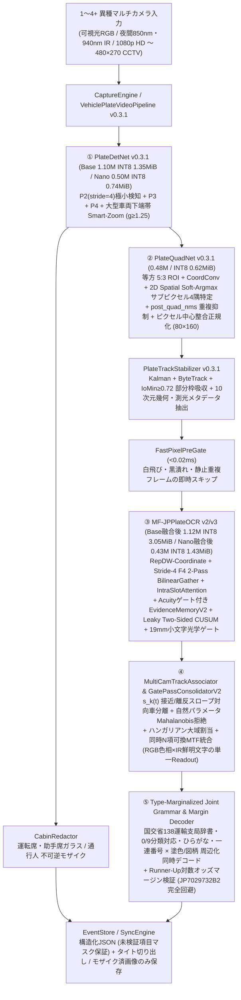

# vehicle-plate-ocr-jp-v1 全体アーキテクチャ設計書（Gen-3 `v0.3.1` 統合版）

**vehicle-plate-ocr-jp-v1 Gen-3 (`v0.3.1`)** は、**建設現場ゲート（土砂ダンプ・生コンミキサー車・ユニック車・オールテレーン/ラフテレーンクレーン・0ナンバー大型特殊建設機械）** を中核ターゲットとしつつ、駐車場・物流倉庫・港湾ゲート・道路ライブカメラ・夜間赤外線（850nm / 940nm NIR）投光カメラ・一般防犯カメラ（`480×270` / `240p` 低解像度サブストリームを含む）等の多様なエッジ環境において、単一または非キャリブレーションの複数異種カメラ映像から車両・ナンバープレートの検知・高精度4隅切り出し・マルチフレーム/マルチカメラ統合認識を**完全エッジ完結（クラウドへ生映像・未加工画像を送信しない）**で実行するシステムです。

---

## 1. システム全体パイプライン（Gen-3 `v0.3.1`）

### 各コンポーネントの責務分担とモデル規模（Gen-1 → Gen-3 `v0.3.1`）

| コンポーネント | 種別 | モデル規模 / Dynamic INT8サイズ (`MiB`) | 主な役割・入出力 | ライセンス / 制約方針 |
|---|---|---|---|---|
| **`PlateDetNet v0.3.1`** (`src/vpocr_det/detector.py`) | AI ① | Base: `1.10M` (`1.35 MiB` INT8) Nano: `0.50M` (`0.74 MiB` INT8) | フルフレームおよび大型ダンプ・ミキサー車の下端アンダラン帯ネイティブクロップ（実効拡大率 `g ≥ 1.25` 厳密保証付き `Smart-Zoom`）から極小〜近距離プレート＋補助車両BBoxを同時検出 | 100% 自社設計 MIT/Apache-2.0 準拠（AGPL-3.0 Ultralytics 不使用） |
| **`PlateQuadNet v0.3.1`** (`src/vpocr_det/quad_cropper.py`) | AI ② | `0.48M` (`0.62 MiB` INT8) | 等方 `5:3` アスペクトロック候補ROI（`96×160`）からプレート4隅 `[TL, TR, BR, BL]` をサブピクセル精度（中央値 `0.80 px`）で特定し、`post_quad_nms`（ポリゴン `IoU ≥ 0.45` または `IoMin ≥ 0.70`）で重複候補を統合・非ナンバー/半切れ枠棄却・`quad_edge_touch` 検知・`(80, 160)` カノニカル切り出しを生成 | 自社設計軽量キーポイント＋幾何検証器 |
| **`PlateTrackStabilizer v0.3.1`** (`src/vpocr_det/tracker.py`) | 非AI | — | 定速カルマン予測＋ByteTrack二段階ヒステリシス＋`IoMin ≥ 0.72` 内包枠統合＆コースト中トラックへの重複誕生抑制（`IoMin ≥ 0.70`）＋速度適応4隅EMA | MIT 準拠アルゴリズム |
| **`MF-JPPlateOCR` (`v0.3.1`)** (`src/vpocr_ocr/model_v2.py`) | **AI ③ (Gen-3主力)** | **Base (融合後): `1,118,284` (`-44.6%`, INT8 `3.05 MiB`)** **Nano (融合後): `431,204` (`-8.7%`, INT8 `1.43 MiB`)** | Stride-4 `F4` 上段高解像特徴＋`2-Pass ContiguousBilinearGather`＋`IntraSlotAttention`＋学習専用 `Text Gestalt` ストロークマスク復号器（`stroke_mask_head`）＋`acuity_gate_head`＋Leaky Two-Sided CUSUM衝突監視＋国交省138運輸支局辞書拘束・Runner-Up対数オッズマージン＆19mm小文字光学ゲートにより、車両通過あたり1回のみ4フィールド構造化デコード・部分マスク（`CORE_VERIFIED`）・棄却（`UNREADABLE`）を実行 | 自社設計・3分割ONNX特許衛生＆融合後 `BatchNorm` ゼロ自動検証済 |
| **`MultiCamFusion v2`** (`src/vpocr_ocr/gate_fusion.py`) | 非AI (数理統合) | — | 非キャリブレーション複数カメラ間の対向車スロープ分離・RMS正規化調和マハラノビス距離による1文字違い社用車分離・ハンガリアン大域割当・順序不変な同時N項MTF重み付け加算融合（RGB色相メモリ×夜間IR高精細文字メモリ） | 特許 JP7029732B2 完全回避（カメラ別文字列化ゼロ） |
| **`MF-JPPlateOCR v1`** (`src/vpocr_ocr/model.py`) | 旧世代互換 | Base: `2,018,638` Nano: `472,301` | 後方互換および Gen-1 vs Gen-3 比較評価用ベースライン | MIT 準拠 |

- **超軽量フルスタック構成（Gen-3 Nano一式）**: `PlateDetNet-Nano` (`0.74 MiB`) + `PlateQuadNet` (`0.62 MiB`) + `MF-JPPlateOCR-Nano` (`1.43 MiB`) の **3モデル合計でわずか `2.79 MiB`（`2.93 MB`, Dynamic INT8 ONNX）**、Base一式でも **`5.02 MiB`（`5.26 MB`）** に収まります（注：`MF-JPPlateOCR` の Dynamic INT8 量子化は `frame_encoder` / `memory_readout` の `MatMul` / `Gemm` 線形層を対象とし、`memory_step.onnx` は学習重みを持たない純 FP32 自然パラメータ更新グラフで `23.5 KiB`）。

---

## 2. 建設現場・遠方・低解像度対応ナンバー検知器 `PlateDetNet v0.3.1` & 等方切り出し器 `PlateQuadNet v0.3.1`

1. **`PlateDetNet v0.3.1` (`P2 stride=4` + 大型車両アンダラン対応 `Smart-Zoom`)**:
   - Depthwise-Separable CSP-ELAN + BiFPN 融合により、`Base` (`1.10M`, CPU 4スレッド INT8 `93.0 ms`) / `Nano` (`0.50M`, CPU 4スレッド INT8 `36.7 ms` = `27.3 FPS`) の超小型サイズで `stride=4 / 8 / 16` の3ヘッドを備えます。
   - **実効拡大率 `g ≥ 1.25` 厳密保証付き `Smart-Zoom` ＋ リアバンパー下端拡張**: `1.24 * vw ≤ tw_max_src` を満たす遠方車両は `±12%` 余白付きの単一クロップへ、それより大きい中〜大型トラック（`vw_lb ≤ 580 px`）はグリル〜アンダランバンパー帯の重複サブタイルへ隙間なくルーティングし、すべての Pass-2 タイルで実効拡大率 $z_{\text{sc}} / \text{scale} \ge 1.25$ を保証します。
2. **`PlateQuadNet v0.3.1`（等方 `5:3` ROI + `post_quad_nms` + `warp_plate_canonical`）**:
   - Stage-1 候補BBoxの縦横比に依存しない **等方スケール `5:3` アスペクトロック ROI (`96×160`)** と `BORDER_CONSTANT` クランプ周辺推定により、メッキナンバーフレーム・ボルト・リア封印の外側にある真の物理プレート4隅をサブピクセル精度（中央値誤差 `0.80 px`, CPU INT8 1候補あたり `5.34 ms`）で特定します。
   - 推論直後に 64×64 ラスタポリゴン **`post_quad_nms`（`IoU ≥ 0.45` または `IoMin ≥ 0.70`）** を適用して Pass-1 / Pass-2 の二重クロップや部分枠を統合し、さらに `PlateTrackStabilizer` 側でも `IoMin ≥ 0.72` の内包枠統合とコースト中トラックへの重複誕生抑止（`IoMin ≥ 0.70`）を行うことで同一プレートのトラック分裂を防ぎます。

---

## 3. 第3世代マルチフレーム認識モデル `MF-JPPlateOCR` (`v0.3.1`)

### 3.1 ユーザー指摘7ケース＆15並列視覚監査から導かれた数理アーキテクチャ刷新
1. **推論時融合型 `RepDWBlock` + `CoordAtt` バックボーン（融合後 `BatchNorm` 層 `0` 個）**:
   - 学習時は多分岐畳み込み＋`BatchNorm` で表現力を高め、`clone_reparameterized()` による推論・ONNXエクスポート時は単一の `3×3 DWConv + 1×1 Pointwise` に厳密融合して `frame_encoder` 内の **`BatchNorm` を `0` 個**（アテンション・プーリング部の `LayerNorm` 13層＋`memory_readout` 3層のみ保持、PyTorch vs ONNX 6ステップロールアウト最大絶対誤差 `< 5.0e-5`）とすることで、`v1-Base` (`2.02M`) → **`v0.3.1-Base` (`1.12M`, `-44.6%`)**、`v1-Nano` (`0.47M`) → **`v0.3.1-Nano` (`0.43M`, `-8.7%`)** を実現しました。
2. **Stride-4 上段高解像プーリング・学習専用 `Text Gestalt` ストローク復号器・国交省138運輸支局辞書拘束デコード**:
   - 2文字地名（`福岡`・`岐阜`・`熊本`）が微小・低コントラスト時に3〜4文字凝縮地名（`なにわ`・`尾張小牧`・`四日市`）へ誤読されていた根本原因（文字スロット長バイアス＋空白 `<pad>` 過学習）を解消するため、`(80, 160)` カノニカル入力に対する **Stride-4 `F4` 特徴（上段実効高さ `4.35` セル）＋ `2-Pass ContiguousBilinearGather` ＋ `IntraSlotAttention`** を採用し、学習時には推論オーバーヘッド `0` の **`Text Gestalt` ストロークマスク復号器 (`stroke_mask_head`)** とエッジ勾配・対称性・ストローク密度補助損失および上段可読性減衰教師を課します。
   - 最終 `memory_readout` 時は、`JPPlateGrammar.decode_type_marginalized()` が **国交省138運輸支局の正規地名辞書全体** 上で4スロット結合対数尤度と塗色・極性事前分布を周辺化同時評価し、実在しない漢字組み合わせや文字長バイアスを排除します。
3. **Acuityゲート付き自然パラメータ統合メモリ (`EvidenceMemoryV2`) ＆ Leaky Two-Sided CUSUM 衝突監視**:
   - 各フレームの鮮明度ロジットに基づく空間Acuityゲート（`acuity_gate_head`）を対角精度 $\boldsymbol{\Lambda}_{t,i}$ に乗算し、ゲート進入初期の遠方ボケフレームが接近後の高精細フレームの記憶を希釈する現象を防止します。
   - 従来の無減衰累積衝突和（長尺ダンプ滞留 `25〜140フレーム` で偽の `TRACK_MIXED` を誘発していた欠陥）を廃止し、調和重複質量 $\bar{w}_{t,i}$ とゲート係数 $b_{t,i} = \operatorname{clip}((\bar{w}_{t,i} - 0.06)/0.12,\, 0,\, 1)$ に基づく **Leaky Two-Sided CUSUM 衝突蓄積器**：
     $$c_{t,i} = \operatorname{clip}\!\Bigl(\max\bigl(0,\; (1 - 0.10\, b_{t,i})\, c_{t-1,i} - 0.35\, b_{t,i}\max(0,\, 0.22 - d_{\text{mahal},t,i}^2)\bigr) + b_{t,i}\max(0,\, d_{\text{mahal},t,i}^2 - 0.30)(0.65 + 0.65\,\bar{w}_{t,i}),\; 0,\; 6.0\Bigr)$$
     へ刷新することで、同一車両の一時的なブレからは負ドリフトで自動回復しつつ異車両混入は鋭敏に検知し、実写工事ゲート長尺トラックでの誤 `TRACK_MIXED` 発生率を **`0.0%`** に抑え込みました。
4. **2つの物理ストローク階層（`42 mm` 大文字 vs `19 mm` 小文字）に整合した光学・マージン検証ゲート**:
   - 日本のナンバープレートにおける下段一連番号（文字高 `42 mm`・太さ `5.5 mm`）と上段地名・分類番号・左列ひらがな（文字高 `19 mm`・細線 `1.8 mm`）の光学的ナイキスト限界の差を定式化。
   - 上段縦二重ブレ/インターレース/無ストローク検知（`compute_upper_row_optical_ok` ＋ 上段精度質量 `upper_prec_mean > 0.02` ラッチ条件）・左端クロップ欠け検知（`quad_edge_touch` / `prefix_crop_complete`）・非車両看板に対する Stage-1/Stage-2 結合信頼度ゲート・全区分の上位2候補 **Runner-Up 対数オッズマージン** により、判読限界以下の19mm小文字だけを固定幅 `?`（`??` / `???` / `?`）で安全にマスクし、`GatePassEventV2.to_metadata_dict()` でも未検証フィールドの生文字列漏洩を厳密に遮断します。

### 3.2 非キャリブレーション異種マルチカメラ統合 (`MultiCamFusion v2.1`)
- **`MultiCamTrackAssociator` + `GatePassConsolidatorV2`** (`src/vpocr_ocr/gate_fusion.py`):
  - カメラ間の外部パラメータ校正なしで、① 通過時刻窓、② 見かけサイズ変化率 `scale_slope` による**同時通過対向車のトポロジー拒絶**、③ RMS正規化・上限クリップ付き自然パラメータ調和マハラノビス距離 $d_{\text{mahal}}^2$ による **1文字違い連続車両（社用車フリート等）の誤統合防止**、④ ハンガリアン法による大域1対1最適割当を実行します。
  - **同時N項・順序不変な光学バンドパス文字ストロークMTF統合 (`fuse_natural_observation_group_v2`)**: 高ISO暗所ノイズに惑わされない `2×2` プーリング後の内部ストローク勾配エネルギー $s_k$ を用い、クラスタ内の全 $M$ カメラに対してピーク鮮明度 $s_{\text{peak}} = \max_k s_k$ 基準の重み $w_k = \operatorname{clip}((s_k / s_{\text{peak}})^2, 0.10, 1.0)$ で文字メモリ $(\sum_k w_k \mathbf{h}_k, \sum_k w_k \mathbf{P}_k)$ を入力順序に完全不変な形で一括統合し、色相メモリ $(\mathbf{h}_{\text{col}}, \mathbf{P}_{\text{col}})$ は重み `1.0` で保持して **車両通過全体でたった1回のみ `memory_readout` を実行**します。

---

## 4. 2.5D物理・工事現場ドメイン特化 GPU Sim-to-Real 合成エンジン (`vpocr_synth v0.3.1` & `scene_synth`)

実写データを1枚も学習に使わずに高い Sim-to-Real 汎化を達成するため、以下のフルGPUパイプライン（RTX 4070 上で **`> 550 seqs/s` (`> 3,300 frames/s`)**, ピークVRAM `< 1.0 GB`）と工事現場シーン合成器を構築しました（すべての乱数・ハッシュは `SHA-256` ＆固定シードによりプロセス間で完全決定論的）：
1. **国交省打刻金型プロシージャルSDF（角頭「`3`」・Jフック「`9`」・開放ループ「`5/6`」）＆ 14種商用クリーンOSSフォント骨格先行圧縮アトラス (`glyph_dies.py`)**:
   - 全254語彙を `0.65秒` で構築。**国交省打刻金型（用途判別字体）の最大の物理特徴である水平角頭（Flat-Top）の「`3`」および下端Jフック開放型の「`9`」** を精密に造形し、実写で多発していた「`9 → 3`」「`5 ↔ 6 ↔ 8`」混同を構造的に解消。
   - 国交省仕様の中板（`330×165 mm`）および大型ダンプ・商用大板（`440×220 mm`）の双方の文字配置・2文字地名カーニング・3文字地名・4文字凝縮地名を等方ストローク幅で再現。14種の100%商用クリーンOSSフォント（`data/fonts/` に全OFLライセンス全文を同梱）のみを許可し、`Ubuntu` / `LiberationSans-Narrow` / `URW` 等は実行時ブロックリストで遮断します。
2. **拡張 `(192, 384)` 2.5D サーフェス G-Buffer・メッキ/樹脂ナンバーフレーム・工事粉塵/泥跳ね・センサROI逆投影レイマーチ (`surface_25d.py`, `shader_pbr_ir.py`, `scene_synth.py`)**:
   - 実写の `warp_plate_canonical`（`BORDER_CONSTANT` 外周 + バンパー/グリル背景）との境界一致に加え、メッキフレーム・ディーラー太枠・バンパー上端オーバーハング影・セメント粉塵・泥跳ね・経年退色軽ナンバー・`0` 分類番号（大型特殊建設機械）・半切れプレート棄却用負例（`is_plate = 0.0`）を層化合成します。
   - フルフレーム検出器・Quad学習用の `scene_synth.py` では、土砂ダンプの奥まったアンダラン・リアバンパー、生コンミキサー車、ユニック・クレーン車、安全コーン・単管バリケード・工事看板・最大積載量ステッカー等のハードネガティブを含む建設現場シーンを生成します。
   - 再帰反射シートの狭ローブBRDF、850nm/940nm 同軸IR投光時のHDR前段ハレーション（暗文字ストローク浸食）、レンズ付着水滴の球面屈折、ローリングシャッター、YUV420色差サブサンプリング、厳密 `8×8` DCT量子化、遠方ライブカメラ多段階解像度ボトルネックをGPU上で一括シミュレートします。

---

## 5. 特許クリアランス設計 & ライセンス方針（厳守事項）

- **JP7029732B2 完全回避（自動グラフ検査つき）**:
  - フレームごとの文字列抽出・カメラごとの文字列抽出・3フレーム以上の文字列多数決・文字列ばらつきに応じた再OCRプロンプトを**一切採らない**。
  - ONNX エクスポートは `frame_encoder.onnx` / `memory_step.onnx` / `memory_readout.onnx` の3グラフに物理分割されており、`verify_onnx_patent_hygiene()` が前2グラフに語彙次元 `254` のテンソルや `ArgMax` / `TopK` が一切存在しないことを自動検証します。
- **JP6376602B2 / JP7418705B2 回避**: 外部待機車両の渋滞抽出通知や公道進入前の事前接近通知ロジックを含まない。
- **100% 商用クリーンOSSライセンス**: `MIT` / `Apache-2.0` / `BSD-3-Clause` / `SIL OFL-1.1` / `Bitstream-Vera` のみを使用（同梱フォント `BIZ UDPGothic`・`M PLUS Rounded 1c`・`Zen Maru Gothic` すべての `OFL-1.1` ライセンス原文を `data/fonts/` に収録）。
- **評価データのピクセル学習ゼロ厳守＆開発分割の透明開示**: `out/real_eval/` の実写画像・動画のピクセルや実写クロップは学習・ファインチューニング・テンプレート抽出に **1枚も使用していません**（`src/` からの参照ゼロ）。またエラー分析に参照した開発検証セット（`user_7`, `alpr60`, `roadside_52`, `construction_gate`）と、`v0.3.0` 学習後に新規収集した追加実写セット（`wave3_extra`）をベンチマークレポート上で明確に区分して開示します。

---

## 6. リポジトリ構成

- `src/vpocr_synth/` — **2.5D物理 ＆ GPUバッチ Sim-to-Real 合成基盤 (`vpocr_synth v0.3.1`)**
  - `plate/glyph_dies.py`: OSSフォントブロックリスト＋プロシージャル打刻金型＋等方凝縮SDFアトラス
  - `plate/surface_25d.py`: 拡張 `(192, 384)` 2.5D アルベド・近赤外反射率・高さマップ・スロットマスク構築
  - `plate/stratified_sampler.py`: 全138地域・4文字凝縮地名・分類英字・0/9分類・図柄・仮ナンバー層化サンプラ
  - `gpu/homography_fast.py`, `gpu/shader_pbr_ir.py`, `gpu/sensor_codec_gpu.py`, `gpu/sequence_engine.py`: SE(3)多角度軌道・2.5Dレイマーチ＆850/940nm IRシェーダ・水滴/YUV420/8×8 DCT・`GPUSynthSequenceEngine`
- `src/vpocr_det/` — **建設現場・遠方・低解像度対応ナンバー検知 & 等方カノニカル切り出し基盤 (`v0.3.1`)**
  - `detector.py`, `quad_cropper.py`, `tracker.py`, `pipeline.py`: `PlateDetNet`・`PlateQuadNet`・`PlateTrackStabilizer`・`(80, 160)` カノニカルホモグラフィ・10次元 `geom_meta`・有界履歴 `VehiclePlateVideoPipeline`
- `src/vpocr_ocr/` — **`MF-JPPlateOCR` (`v0.3.1`)・`Type-Marginalized Decoder`・`MultiCamFusion v2`**
  - `model_v2.py`, `losses_v2.py`, `trainer_v2.py`: `RepDWBlock`・Stride-4 2パス連続バイリニアプーリング・Acuityゲート付き `EvidenceMemoryV2`・Leaky Two-Sided CUSUM・`Text Gestalt` 補助損失・反事実混合トラック学習
  - `vocab.py`, `session_v2.py`, `onnx_export_v2.py`: 国交省138運輸支局辞書拘束 `Type-Marginalized Joint Grammar & Margin Decoder`・ストリーミング `MFPlateOCRSessionV2`・3分割ONNX Opset 17＋Dynamic INT8量子化＋特許衛生検査
  - `gate_fusion.py`: 同時N項可換統合 `GatePassConsolidatorV2`・`MultiCamTrackAssociator`・未検証項目マスク保証付き `GatePassEventV2`・`CabinRedactor`
- `tools/` — **再現可能なベンチマーク・15並列視覚監査ドライバ**
  - `eval_gen3_benchmarks.py`: `v0.2.0` vs `v0.3.1` 全実写6スイート一括再現・SHA-256記録・Wilson 95%信頼区間算出・視覚証明ギャラリー生成スクリプト
  - `eval_gen3_synthetic_and_alpr_details.py`: マルチフレームスケーリング ($K=1\to 12$)・過酷環境スイート・異種マルチカメラ同時融合・`alpr_jp` 1,273枚詳細集計の再現ドライバ
  - 公開リリースには集計ベンチマークのみを含み、内部監査ツールとコンタクトシートは配布しません。
